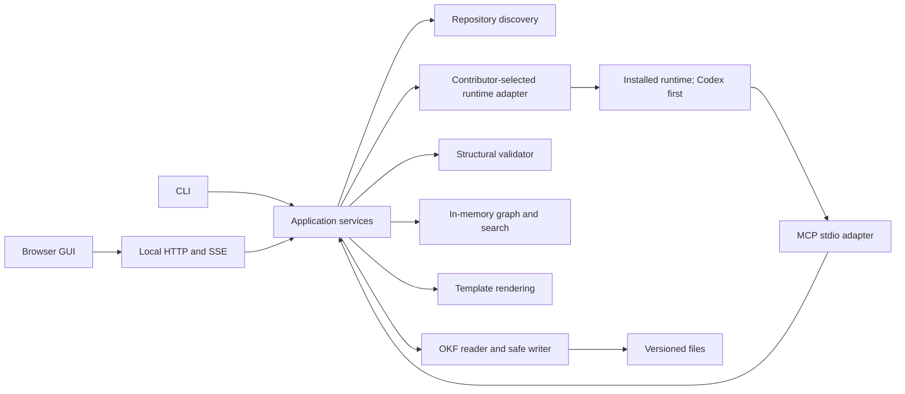

# Architecture and implementation boundaries

**Proposal — LLM design:** implement the backend/CLI as Go with pure-Go dependencies and embedded browser assets. Use a small TypeScript frontend compiled at development time and embedded into the executable. Users need no Node, Python or asset build pipeline at runtime. The [operator](../sources/operator-brief.md) required a portable static binary but did not choose a language. Go's [embed package](https://pkg.go.dev/embed) supports bundling assets; the [Go build documentation](https://go.dev/doc/install/source#environment) describes target OS/architecture controls. These capabilities do not themselves prove our eventual executable is correctly linked.

## Components

All frontend/tool transports share application services and diagnostics. No adapter writes files directly. Pure functions parse/validate records and assemble deterministic views; a small filesystem layer handles locks, revision comparison and atomic replacement. Discovery resolves Git roots without changing Git state. The graph is derived from the working tree, rebuilt after restart and incrementally refreshed after changes.

## Proposed source layout

`cmd/factoryctl/` is the executable entrypoint. `internal/project/` owns metadata/discovery; `internal/runtime/` resolves contributor preferences outside Git and dispatches supported adapters; `internal/knowledge/` parses documents and definitions; `internal/validation/` owns structural checks; `internal/store/` owns safe I/O; `internal/graph/` handles relationships/search; `internal/templates/` handles record/prompt rendering; `internal/app/` owns use cases; `internal/transport/{cli,mcp,http}/` adapts interfaces; `internal/runtime/codex/` owns subprocess/protocol integration. `web/` contains browser source; embedded default knowledge/templates live under `internal/defaults/`. Test fixtures belong in `testdata/`, outside the live knowledge graph. The source repository uses ordinary Go/frontend manifests; those are build inputs, not factoryctl runtime persistence.

Start with standard-library HTTP/JSON/embed/templates and a maintained YAML/Markdown AST parser plus the official MCP Go SDK if compatible. Pin exact dependencies when implementation begins; no dependency version is claimed selected here. Reject libraries that force a user-side native runtime or C toolchain. Keep GUI component boundaries small; framework choice is delegated to the GUI task within this interface contract, not an unresolved product requirement.

## Storage, concurrency and failure boundaries

`factory/` contains current metadata; root config and optional assets remain outside it. [Knowledge-format](../specifications/knowledge-format.md) defines revision tokens, advisory coordination, unknown-key preservation, path identity and the limits of non-cooperating editors. Structural errors disable affected writes, not the entire viewer. [Validation](../specifications/validation.md) defines rejection rules; no opaque truth/approval engine is introduced.

Browsing, searching, editing, init and validation work without any agent runtime, personal preferences or network access. Conversation features are separately available only when the runtime qualifies. The application server owns only transient conversation routing and UI event streams. Agent process failure cannot corrupt graph state merely by dropping the transport. Git conflicts are surfaced, never resolved internally.

## Deployment and portability

Desktop: run `factoryctl gui`, serve loopback, open the OS browser; closing the process stops its owned children. Server/Kubernetes: mount an existing Git checkout and optional user-selected runtime installation/credentials, bind an explicitly selected interface behind external infrastructure, handle SIGTERM gracefully. Factoryctl does not clone/synchronize repositories or provision credentials. CI: use noninteractive CLI commands against an existing checkout; stdout JSON is transient output.

Build with `CGO_ENABLED=0` for each supported `GOOS/GOARCH` and inspect dependencies/linkage. Interpret “static” as a single self-contained factoryctl binary with embedded UI and no separately installed application libraries; macOS/Windows still have normal platform-loader/system-library interfaces, and Git/Codex/browser remain explicit external programs. Do not promise fully static Darwin linkage. [Portability decision](../decisions/portable-binary.md) records this interpretation for operator review. Only macOS ARM64 execution testing is currently authorized; cross-compilation is useful but not execution evidence.

## Scale budget and observability

The confirmed workload is 100 repositories/10,000 nodes. Proposed qualification corpus: 100 MiB total UTF-8 Markdown, with a defined distribution of links and 1 MiB maximum file size. Measure cold scan, incremental update, query latency and resident memory on the actual Mac. Initial targets: cold scan <5 s, cached list/search p95 <200 ms, disk-edit visibility <1 s after debounce, RSS <512 MiB excluding Codex/browser. These are proposed thresholds to measure, not achieved results. Report hardware, corpus and sampling method; optimize only from evidence.

Log diagnostics to stderr with project/ref context and omit secrets/prompt bodies by default. No persistent telemetry store or background daemon. `doctor` reports capabilities and paths; it does not repair files without explicit actions.

## Design readiness

Scope and contracts are specified for implementation. The [runtime spike](../tasks/07-codex-adapter.md), [platform qualification](../tasks/11-release-qualification.md), and [custom-view tests](../tasks/09-custom-views.md) own the major technical risks. Their empirical outcomes are unknown. No application implementation is implied by document review. The [roadmap](implementation-plan.md) identifies dependencies, handoffs and acceptance.
